**FarmLab is a working laboratory for automated aeroponics: a lab regulated by the plants themselves.**

**See it live:** [the FarmLab page](https://automated-aeroponics-innovations.github.io/FarmLab/) runs a simulation of the lab in your browser (a grow wall with its light and mist cycles, the sensor loop that lets plant stress drive the misting, and the retraining cadence that keeps the controller current), beside the photographs below.

---

## Why

The ultimate goal of FarmLab is to one day produce a scalable, ML-operated aeroponics pilot program that can support the subsistence agriculture needs of communities in food deserts: serving thousands of people from a single site the size of a football field. This endeavor was largely inspired by the research conducted by [NASA on the ISS](https://www.nasa.gov/content/growing-plants-in-space).

One day very soon, every city will have many [vertical farming implementations](https://verticalharvestfarms.com/) snuggled between its skyscrapers, providing produce to local grocery stores and removing worries about supply-chain interruption. Beyond food insecurity, these digital farms are the key to the logistics of one day living on Mars. Aeroponics is only truly viable at scale, though, when it is fully automated and adaptable to unanticipated changes in its environment. Changes in the environment or shifts in key nutrient levels can occur with seeming randomness that a well-trained algorithm might not anticipate; that requires an automated pipeline that retrains and redeploys the controller on fresh data, so that what would look anomalous to a fixed model becomes, with each new dataset, previously unobserved insight.

The other contributing factor is the sensor. In 2017 MIT published research on nanofluidic sensors that signal [water stress in plants](https://news.mit.edu/2017/sensors-applied-plant-leaves-warn-water-shortage-1108), and Cornell's [digital agriculture research center](https://news.cornell.edu/stories/2021/09/25m-center-will-use-digital-tools-communicate-plants), where Dr. Abraham Stroock's group reads the water held in the vessels of a single leaf, carries the same idea forward. The core proposed principle of FarmLab is in-vivo biosensing of plant stress driving the automated functions of a precision agriculture system:

*Coppedè N., Janni M., Bettelli M., et al. An in vivo biosensing, biomimetic electrochemical transistor with applications in plant science and precision farming. Sci Rep 7, 16195 (2017). [doi:10.1038/s41598-017-16217-4](https://www.ncbi.nlm.nih.gov/pmc/articles/PMC5700984/)*

Think of FarmLab as one of the first handful of prototypes for systems so precise that they regulate nutrient delivery and lighting from the reading on a single leaf. Not simply a lab automated by machine learning, but a lab regulated by the very plants in it. Taken one step further, a biosensor-and-retraining loop of this kind is an artificial biofeedback system, built to emulate an autonomic response; the same preparation applies to prostheses that must one day sense as the limbs they replace (see *Zhuang K. Z., Sommer N., Mendez V., et al. Shared human–robot proportional control of a dexterous myoelectric prosthesis. Nat Mach Intell 1, 400–411 (2019). [doi:10.1038/s42256-019-0093-5](https://doi.org/10.1038/s42256-019-0093-5)*).

## The lab today

Photographs from the lab, 2026.

| | |
|---|---|
| 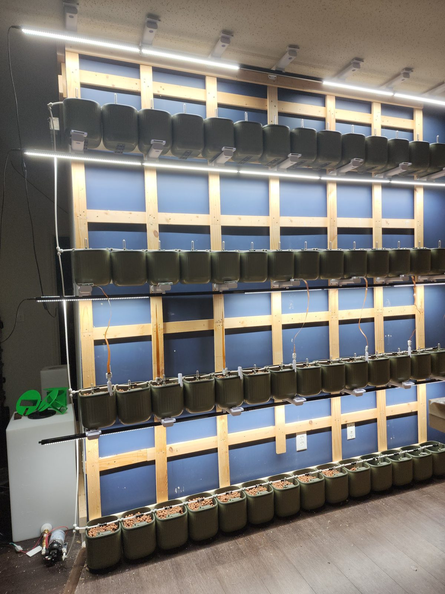 | 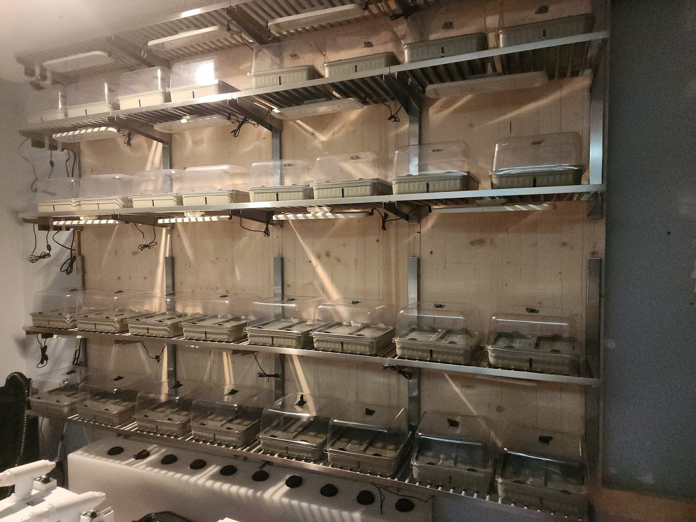 |
| **The grow wall.** Four tiers of pots on a timber frame under LED bars, the lab's first vertical aeroponic wall. | **The propagation wall.** Domed seedling trays and net-pot inserts, where every planting starts. |
| 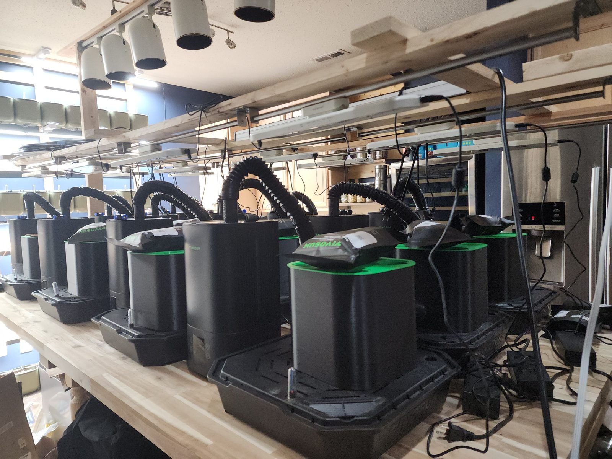 | 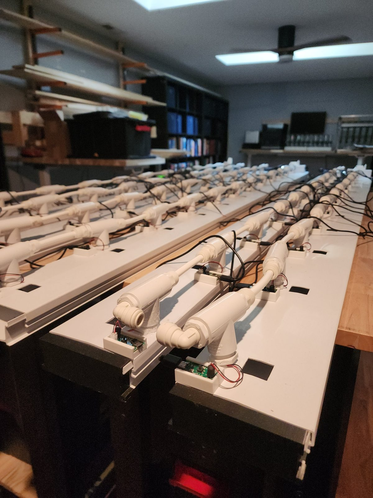 |
| **Fogging chambers.** Sealed grow chambers on the bench with ducted misting, the unit of the modular fogging system. | **The fogging manifold.** The modular manifold assembled along the bench with its drivers: one mister per station, addressable. |
| 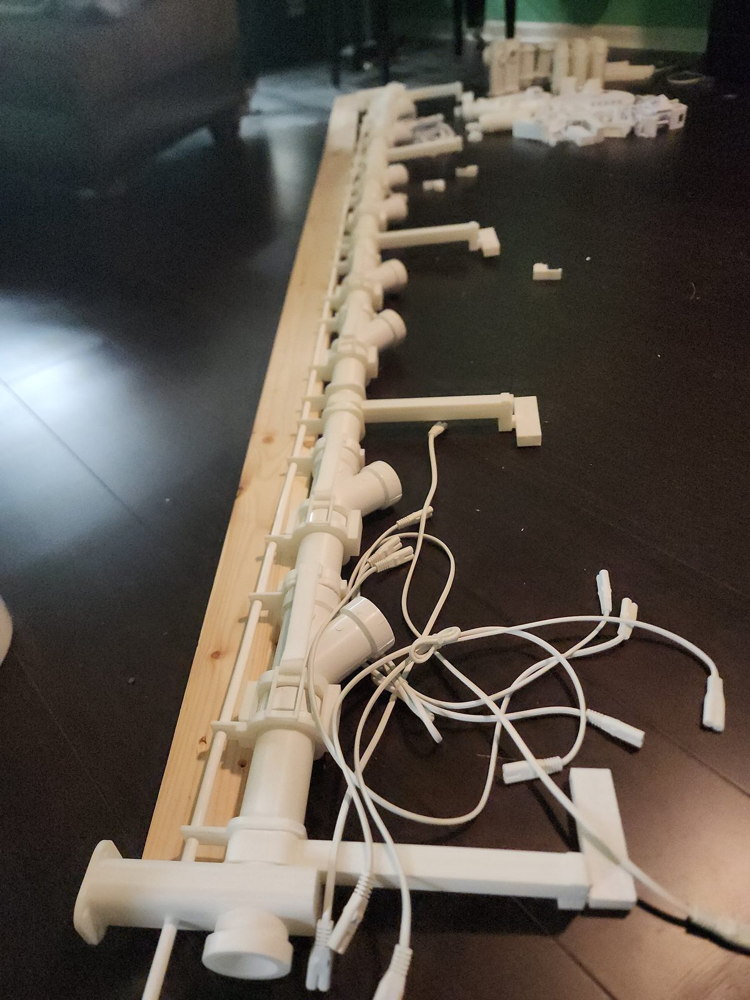 | 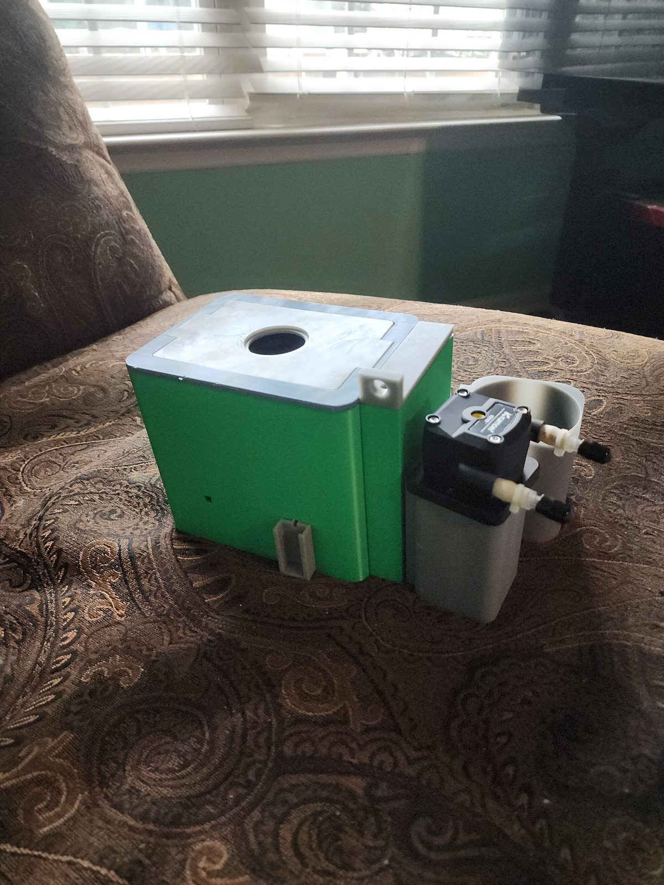 |
| **Manifold prototype.** The printed manifold wired for its misters before it goes onto the wall. | **Dosing unit.** A printed enclosure with a peristaltic pump, the nutrient dosing stage. |
| 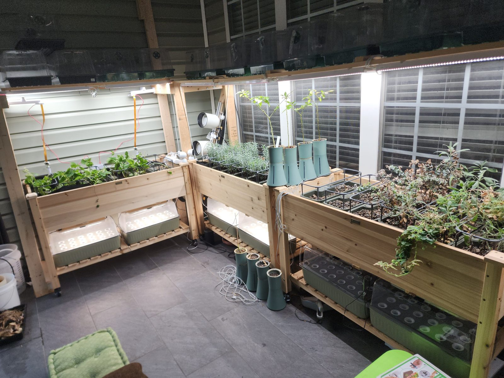 | 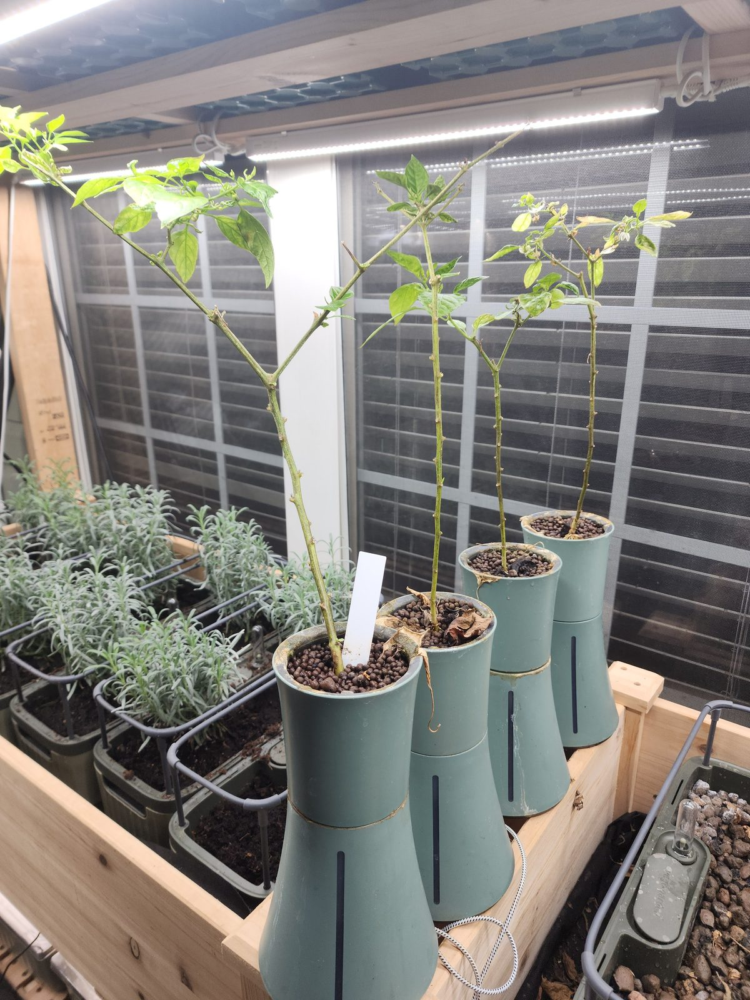 |
| **Raised beds.** Soil beds under lights in the sunroom: the control condition and the kitchen garden. | **At the window.** Self-watering pots and lavender trays, grown alongside the automated wall. |
| 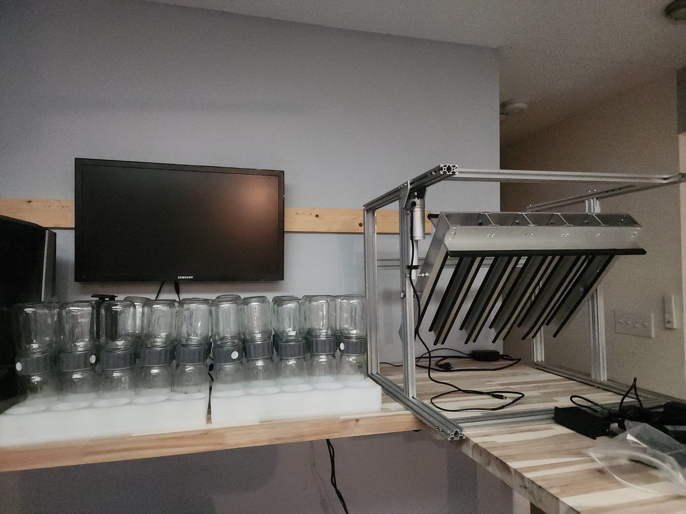 | 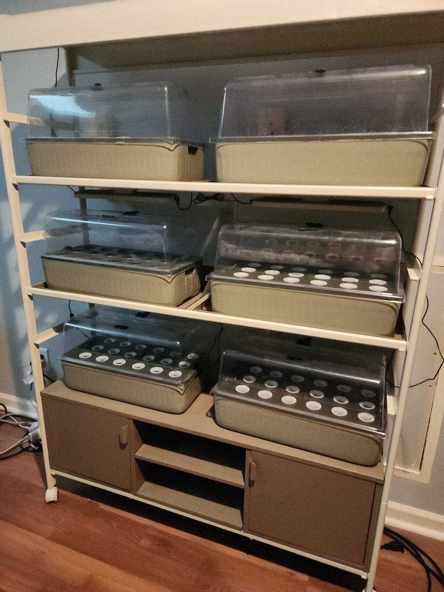 |
| **The light rig.** LED bars on aluminium extrusion over the jar rail, with the lab display behind. | **Seed starting.** Domed trays with net-pot inserts on the rack. |
| 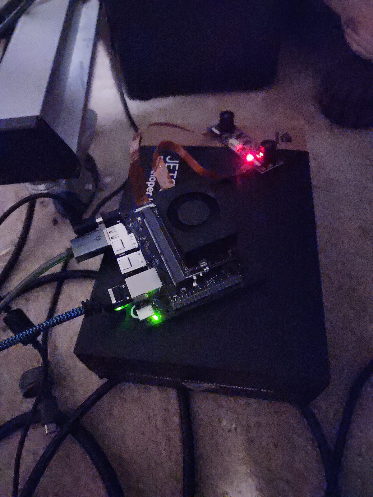 | 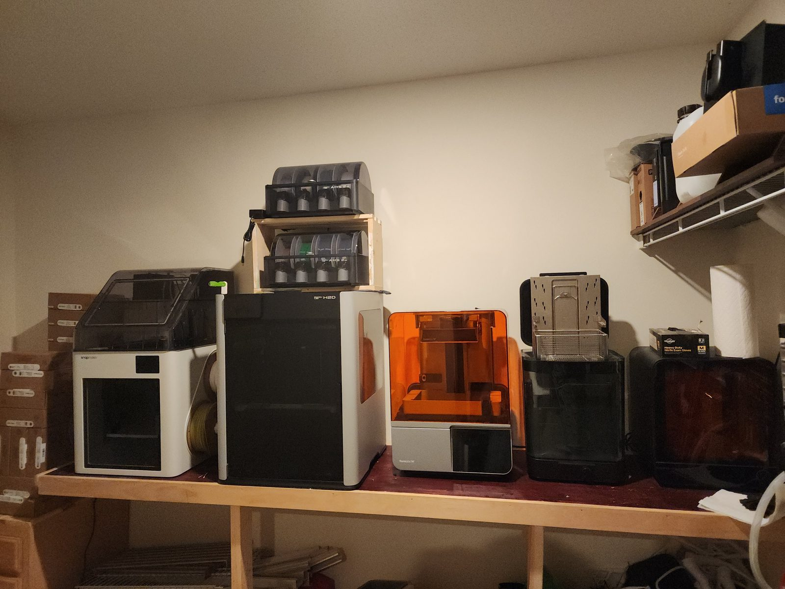 |
| **Edge vision node.** A Jetson Orin Nano with its camera module: the lab's eyes, running detection at the edge. | **Fabrication.** Resin and filament printers with wash and cure stations; most of the lab's fittings are printed here. |
| 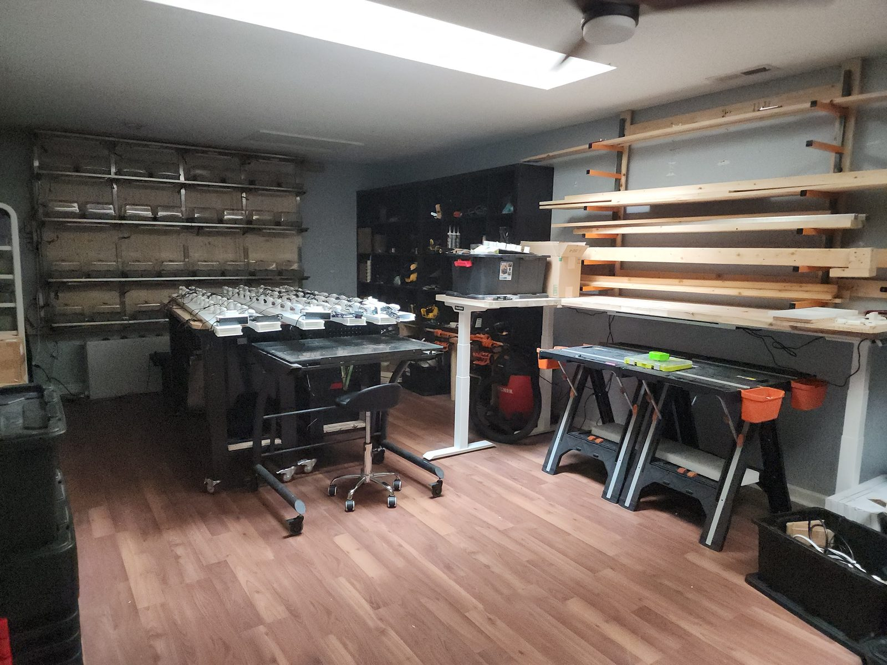 | 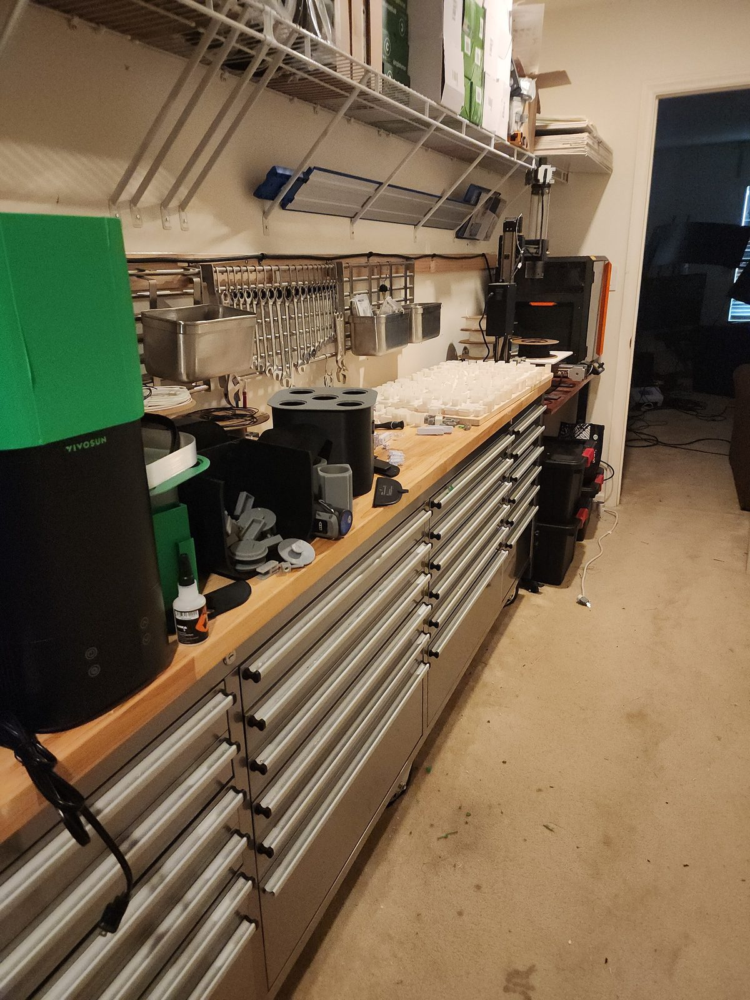 |
| **The floor.** Bench, desk and lumber for the next wall. | **Tools and parts.** The tool wall and drawers that keep the build moving. |

## What FarmLab is building

- **A modular fogging system.** Addressable misters on a printed manifold, sealed chambers, and a dosing stage with peristaltic pumps. Designed in CAD, printed in the lab, iterated on the wall.
- **A sensing layer that reports honestly.** Small sensor nodes that never report a number they did not measure, never stop silently, and say why they restarted.
- **A camera layer.** Time-lapse ground truth of the growth beds from fixed cameras, with depth and reconstruction to follow, built consent-first so that what the cameras see can be forgotten on request.
- **A controller that is retrained, not just trained.** Fresh data retrains the model on a cadence; anomalies become the next dataset.

## Projects in flight with direct bearing on FarmLab

| Project | What it is | Where |
|---|---|---|
| **FarmLab Product Development** | The CAD and hardware line: aeroponics assemblies, the modular and large-scale fogging systems, lighting support, seed storage, the kitchen-garden support and the attic system. | Automated Aeroponics Innovations, in development |
| **AgriDash** | Firmware for a small environmental sensor node on a Raspberry Pi Pico, C++17, built test-first to a written specification, with a defined behaviour for every failure. Its page runs the firmware in your browser. | [AgriDash](https://github.com/anthemrukiyawingate/AgriDash) · [live page](https://anthemrukiyawingate.github.io/AgriDash/) |
| **FarmLab 4D digital twin** | A spatial-time layer beside the numeric sensors: time-lapse stills from fixed cameras, then monocular depth, then static 3D reconstructions, aligned over time. Phase 1 is pre-registered; consent and a right to forget are part of the design. | In preparation |
| **PhytoSync** | Plant-sensor synchronization: aligning sensor streams to the plant's own rhythms so that readings are compared like with like. | Maintenance |
| **MUPLab** | Ultrasonic plant stress detection: listening for the acoustic emissions of stressed tissue as a non-contact stress signal. | Active research |
| **Edge vision node** | Camera-based monitoring on a Jetson Orin Nano, with on-device detection and alerts; the first unit is in field use. | Active |
| **Clockwork Garden** | A simulated mycorrhizal network in which fungal colonies evolve a shared signalling language through cooperation. The emulated garden is the design for a living one; FarmLab is where that living garden would be grown. | [Clockwork Garden](https://github.com/anthemrukiyawingate/clockwork-garden) |

## Developer

Anthem Rukiya J. Wingate · [LinkedIn](https://www.linkedin.com/in/anthemrukiya/)
